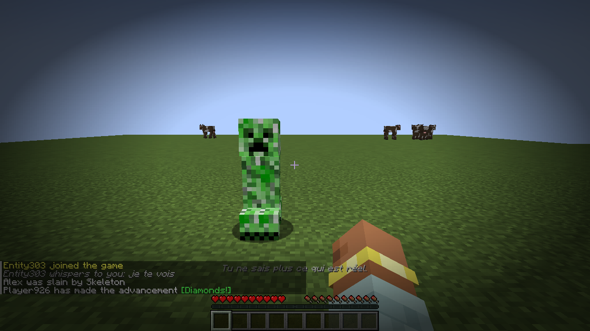
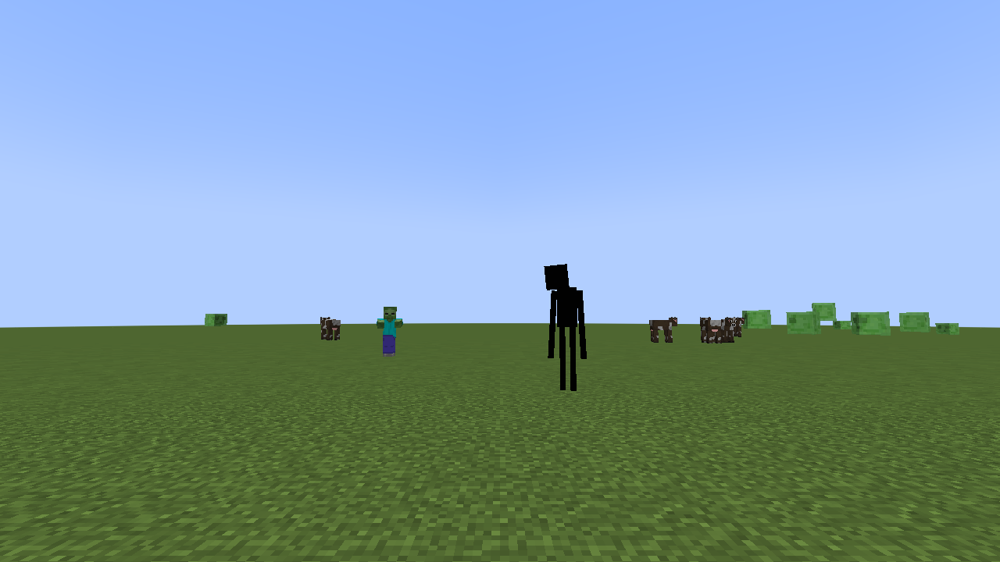
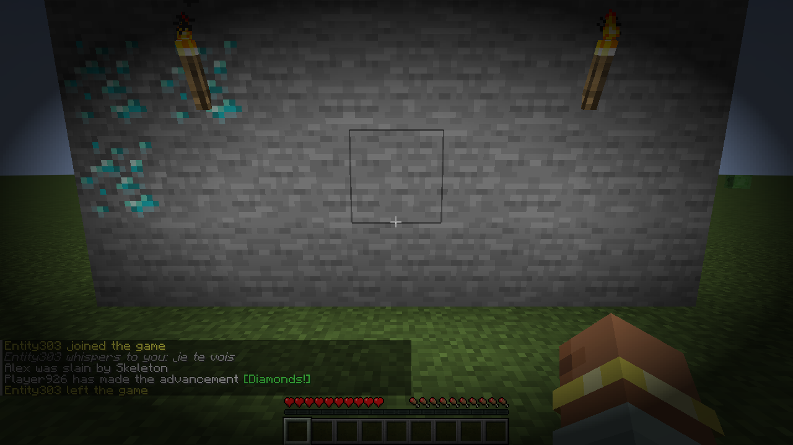

# Schizocraft

Mod Fabric pour Minecraft 1.21.11. Seul dans le noir et sans dormir, ton personnage perd pied : il **entend des bruits qui n'existent pas**, **voit des mobs fantômes** et reçoit de **faux messages**. Tout est envoyé à lui seul : les autres joueurs ne voient et n'entendent rien, et impossible de savoir ce qui est réel.



## Paranoïa

Chaque joueur a une jauge de paranoïa de 0 à 100 %. **Elle n'est pas affichée** : tu ne sais jamais où tu en es.

| Ça monte | Ça descend |
|---|---|
| Être dans le noir (lumière ≤ 3) : 100 % en 7 minutes | Être avec quelqu'un : joueur, villageois ou animal apprivoisé |
| Être seul, à plus de 24 blocs de tout le monde | Être dehors en plein jour |
| Plus de 3 jours sans dormir | Une nuit de sommeil : **−50 %**, et tout disparaît |
| Prendre des coups | Une sieste : −10 % |

Mourir ne guérit pas : on revient à moitié moins paranoïaque.

## Stades

| Stade | Paranoïa | Hallucinations |
|---|---|---|
| Lucide | 0 – 25 % | Aucune |
| Nerveux | 25 – 50 % | Des bruits, toutes les 45 à 90 s |
| Paranoïaque | 50 – 75 % | Bruits, mobs fantômes et faux messages, toutes les 18 à 40 s |
| Délire | 75 – 100 % | Tout, toutes les 7 à 18 s |

Un message discret t'avertit seulement quand tu changes de stade (« Tu as l'impression d'être observé. »).

## Hallucinations

**Bruits** : un creeper qui siffle dans ton dos, des pas qui se rapprochent, une porte qui s'ouvre et se referme, quelqu'un qui creuse vers toi dans la roche, une mèche de TNT, une flèche qui se plante à côté de toi, des grognements, ton cœur qui bat.

**Mobs fantômes** :

- un **creeper allumé juste derrière toi**, qui disparaît dès que tu te retournes ;
- un **zombie, squelette ou enderman** qui te fixe au loin, et s'évapore quand tu le regardes trop longtemps ou que tu t'approches ;
- **l'Ombre**, une silhouette noire trop grande aux yeux blancs, au coin de ton champ de vision ;
- en délire, quelque chose qui **te suit** et se rapproche quand tu ne regardes pas.

**Faux messages**, identiques aux vrais et dans la langue du joueur : « Herobrine a rejoint la partie », des chuchotements (« je sais où est ta base »), la mort d'un autre joueur, ton propre progrès « Diamants ! ».

**En délire** : des **faux diamants** apparaissent dans les murs (en les cassant, c'est de la pierre), les **torches s'éteignent** quelques secondes, tu **prends des coups** qui n'enlèvent aucun cœur, l'écran devient noir un instant.

| L'Ombre | Délire : faux diamants et faux messages |
|---|---|
|  |  |

## Commande

Réservée aux ops : le joueur, lui, ne doit pas pouvoir vérifier ce qui est réel.

| Commande | Effet |
|---|---|
| `/paranoia <joueur>` | Voir sa paranoïa |
| `/paranoia set <joueur> <0-100>` | La régler |
| `/paranoia hallucination <joueur> <type>` | Lui envoyer une hallucination précise |

## Installation

1. Installer [Fabric Loader](https://fabricmc.net/use/) pour Minecraft 1.21.11.
2. Mettre [Fabric API](https://modrinth.com/mod/fabric-api) et le jar des [Releases](https://github.com/luuuccasss/schizocraft/releases) dans le dossier `mods/`.

Le mod s'installe **sur le serveur**. Côté joueurs, il est **facultatif** :

- **sans le mod**, tout fonctionne avec un Minecraft normal, l'Ombre est remplacée par un enderman ;
- **avec le mod**, l'Ombre apparaît en 3D et les bords de l'écran s'assombrissent avec la paranoïa, en battant comme un cœur au stade délire.

Il marche aussi en solo.

Le mod joue sur la paranoïa et les hallucinations pour faire peur ; ce n'est pas une représentation de la schizophrénie.

## Compiler

```sh
./gradlew build
```

Le jar se trouve dans `build/libs/`. Les vitesses de la jauge se règlent en haut de `Mind.java`, les seuils et la fréquence des hallucinations dans `Stage.java`, les hallucinations elles-mêmes dans `Hallucination.java`.
